# ProcureMind AI

An accounts-payable system with an exception-handling agent. It reads supplier invoices, purchase orders and goods receipts, matches them, checks them for duplicates and anomalies, and routes each payment to the people who approve it. When an invoice does not match, the agent gathers the evidence and recommends an outcome; a person accepts or decides. It is for accounts-payable teams that need each payment matched against what was ordered and received, and for engineers who want to see document AI and an agent built with provenance and typed tools. It is a portfolio project built on synthetic data. It is not a customer deployment and has not been run in production.

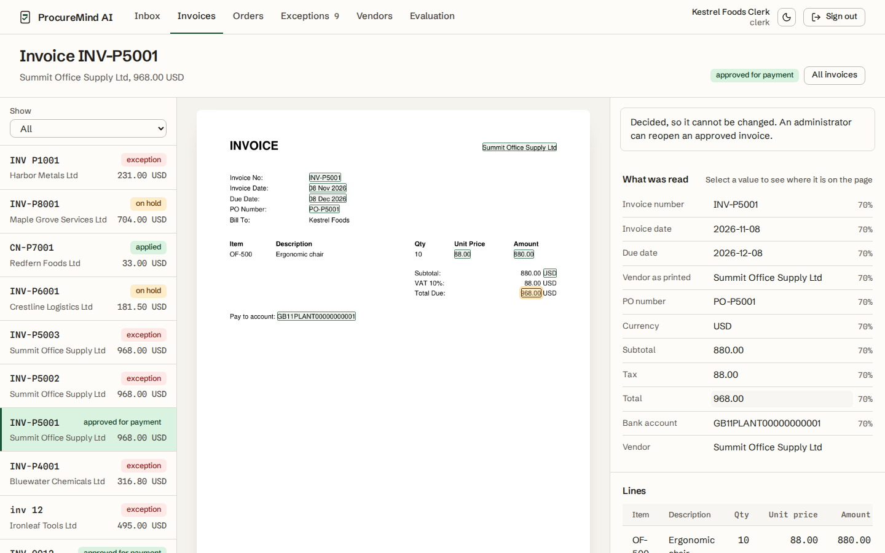

**[Live demo](https://rafi0020.github.io/ProcureMind/)**: the real web interface on GitHub Pages, answered from responses recorded on the running system (API, database, worker and model). Sign in with a demo account from the login page. Runs replay as they were recorded and changes are not saved. [How the demo works](frontend/demo/README.md).

## Features

**Intake and reading**
- Files are typed by their content and stored once per organisation by SHA-256; uploads arrive from the UI or from a forwarding system through the inbox endpoint.
- Digital PDFs use their text layer; scans and photos use Tesseract OCR. Each word keeps its position.

**Extraction**
- Rules, and optionally a model, propose the header fields and line items.
- A value is stored only if it is found on the page, and the review screen shows where each one was found.
- Printed arithmetic (line amounts, subtotal, tax and total) is checked.

**Matching and checks**
- Each invoice is matched to its purchase order and to the goods received, line by line, with price and quantity tolerances, partial deliveries, several invoices against one order, and credit notes.
- The match is deterministic and uses no model.
- Duplicate numbers and amounts, a bank account that differs from the vendor's, a price far above the vendor's history, and invoices split to stay under an approval limit each raise a finding with a reason.

**Exceptions and the Exception Agent**
- An invoice that fails the match or raises a finding is held and opens one exception.
- The agent reads the records through typed read-only tools and stores one recommendation: approve with variance, hold, request a credit note, request a corrected invoice, reject as duplicate, or escalate. It may also store a draft message to the supplier.
- Every figure in its report is checked against the evidence it read.
- The agent cannot approve, pay, edit an invoice, change a vendor's bank details or send anything.

**Decisions and approvals**
- A person accepts or changes the recommendation. Whoever started the investigation cannot accept it while another approver is available.
- Approval tiers depend on the amount, and separation of duties stops the people who entered, corrected or matched an invoice from approving it.
- The end state is recorded as `approved`. Nothing is paid by this system.

**Platform**
- Organisations with row-level security in PostgreSQL, sessions in HttpOnly cookies, and four roles: viewer, clerk, approver and admin.
- An audit log, budgets for agent runs with per-run and per-day cost limits, and model settings that an administrator can change in the UI.
- Background workers coordinated through PostgreSQL, scalable with Docker Compose; one-command startup.

## Architecture

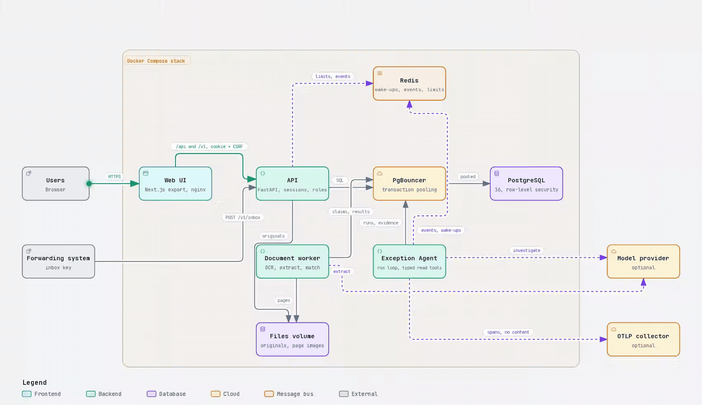

[Live demo](https://rafi0020.github.io/ProcureMind/) · [Architecture diagram](https://rafi0020.github.io/ProcureMind/diagram/) · [Architecture notes](docs/ARCHITECTURE.md) · [Database schema](docs/DATABASE.md) · [API reference](docs/API.md)

| Layer | Technology |
|---|---|
| Web UI | Next.js 15 (static export), React 19, Tailwind CSS 4, SWR, served by nginx |
| API | FastAPI, SQLAlchemy (async), Pydantic, Alembic migrations |
| Workers | Python worker process (`app.worker.run`): document queue, agent runs and scheduler, coordinated through PostgreSQL |
| Data | PostgreSQL 16 with forced row-level security; PgBouncer in transaction pooling mode |
| Events and limits | Redis 7: wake-up signals, run event streams, rate-limit counters |
| Document processing | PyMuPDF, Tesseract OCR through pytesseract, openpyxl |
| Model providers (optional) | Anthropic, OpenAI-compatible endpoints, Ollama, or the built-in script (`stub`) |
| Observability | Prometheus metrics; OpenTelemetry spans over OTLP (optional) |

## Getting started

### Docker

Requires Docker with Compose v2. The defaults work without a `.env` file.

```bash
docker compose up --build
```

- Web UI: http://localhost:3300
- API documentation: http://localhost:8300/docs (bound to 127.0.0.1)

The first start applies the migrations, creates the demo organisations and loads the demo data. Copy `.env.example` to `.env` to change a setting. [Configuration](#configuration) lists the main ones; `.env.example` lists every variable with its default.

### Local development

Requires Python 3.13 with [uv](https://docs.astral.sh/uv/), Node 22 and Docker.

```bash
make dev-up                                       # the three data services on their local ports
cd backend && uv sync
export FILES_DIR="$HOME/procuremind-files"        # the default /data/files is for containers
uv run python -m app.bootstrap                    # migrations, then the demo data
uv run uvicorn app.main:create_app --factory --port 8000
uv run python -m app.worker.run                   # document queue, agent runs and scheduler; second terminal
```

To work on the UI, run `npm run dev` in `frontend/` with `NEXT_PUBLIC_API_URL=http://localhost:8000` so that API calls reach the API directly. Production builds are served by nginx on the same origin as `/api`.

### Tests and evaluation

```bash
make dev-up                  # PostgreSQL, PgBouncer and Redis on local ports, for the tests
make check                   # lint (ruff) and the backend tests; no model needed
make test-ocr                # OCR tests, in the test image that has Tesseract (docker compose --profile test)
make test-live               # tests that call a real model; reads NINEROUTER_API_KEY from the environment
```

The browser journeys run against the full stack:

```bash
docker compose up -d
cd frontend && npm ci && npx playwright install chromium && npx playwright test
```

They cover upload to approval, an exception to a decision, a duplicate caught, separation of duties, sign-in and navigation by role, and one organisation not seeing another's invoices. The frontend also has `npm run typecheck` and `npm run lint`.

Evaluation runs in the test image. Each target reads `NINEROUTER_BASE_URL` and `NINEROUTER_API_KEY` from `../.env.local`, a file one folder above this repository; without it the target fails before it starts.

```bash
make eval-extraction                              # rules alone; MODEL=cc/claude-sonnet-5-5 adds a model
make eval-matching                                # rebuilds the demo in the test database
make eval-build                                   # the agent's cases, in their own organisation, development database
make eval-agent SPLIT=dev MODEL=cc/claude-sonnet-5-5
make eval-attacks MODEL=cc/claude-sonnet-5-5      # ONLY=case,case re-runs selected cases
```

Load measurements are reproduced with `docker-compose.load.yml` and the scripts in `backend/load/`; the steps are at the end of [docs/SCALE.md](docs/SCALE.md).

## Demo accounts

Two organisations are created: **Kestrel Foods** (`*@kestrel.demo`) and **Ridgeway Clinics** (`*@ridgeway.demo`). Each has one account per role, created by `backend/seed/demo_users.py`:

| Role | E-mail | Password |
|---|---|---|
| Admin | `admin@kestrel.demo`, `admin@ridgeway.demo` | `Admin#Demo2026` |
| Approver | `approver@kestrel.demo`, `approver@ridgeway.demo` | `Approver#Demo2026` |
| Clerk | `clerk@kestrel.demo`, `clerk@ridgeway.demo` | `Clerk#Demo2026` |
| Viewer | `viewer@kestrel.demo`, `viewer@ridgeway.demo` | `Viewer#Demo2026` |

These are public demo passwords. They can be changed with `DEMO_ADMIN_PASSWORD` and the other `DEMO_*_PASSWORD` variables before the first start.

| | Viewer | Clerk | Approver | Admin |
|---|---|---|---|---|
| Read documents, invoices, orders, matches, exceptions, vendors | yes | yes | yes | yes |
| Upload, correct extracted fields, match by hand, start the agent on an exception | no | yes | yes | yes |
| Accept or decide an exception, send a waiting invoice back, approve invoices waiting for approval | no | no | yes | yes |
| Create vendors, decide bank-account changes, reopen an approved invoice, change tiers, people, inbox keys and model settings | no | no | no | yes |

A bank-account change is requested by one administrator and decided by another. A sole administrator may decide it, and the decision is recorded.

[`samples/`](samples/README.md) holds two copies of an invoice that Kestrel Foods already received, sent again under other spellings of its number. Upload either one as a clerk to see it become a duplicate exception.

### The demo without a model

The demo runs with `LLM_PROVIDER=stub`. Extraction then uses the rules alone, and the Exception Agent runs a fixed script. Its report says it is a script. To use a model, set `LLM_PROVIDER`, `LLM_BASE_URL`, `LLM_API_KEY` and `LLM_MODEL` in `.env`, or under **Administration → Model settings** as an administrator. Every provider and its settings are in [docs/PROVIDERS.md](docs/PROVIDERS.md). A model server on the host is reached at `http://host.docker.internal:<port>/v1`.

## Tutorial

This walkthrough follows the demo as a clerk, an approver and an administrator. It takes about 30 minutes. Start the stack with `docker compose up --build` and wait until the `migrate` container has exited successfully (it loads the demo data), then open http://localhost:3300.

### 1. Sign in as a clerk

1. On the sign-in page, click **Fill in** beside *Clerk* in **Demo accounts**. Or type `clerk@kestrel.demo` into **E-mail** and `Clerk#Demo2026` into **Password**.
2. Click **Sign in**. You land on **Inbox**. The demo has already loaded documents, and the drop zone reads *Drop files here or choose them*.

### 2. Look at the planted exceptions

The demo plants eight cases in Kestrel Foods (`backend/seed/generate.py`). Each one exercises a different control:

| Case | Invoice (vendor) | What it tests |
|---|---|---|
| Price over tolerance | `INV-P1001` (Harbor Metals Ltd) | 21.00 billed against 20.00 ordered; the tolerance is 2 % |
| Partial delivery | `INV-P2001` (Northgate Packaging Ltd) | 10 billed, 6 received: quantity over received |
| Duplicate under another spelling | `INV-0012` and `inv 12` (Ironleaf Tools Ltd) | The same number written two ways; the second copy is held as a duplicate |
| Changed bank account | `INV-P4001` (Bluewater Chemicals Ltd) | The account on the invoice differs from the one on file |
| Split under the approval limit | `INV-P5001` to `INV-P5003` (Summit Office Supply Ltd) | Three invoices just under the 1,000 limit that add up to more than it |
| No purchase order | `INV-P6001` (Crestline Logistics Ltd) | The order number printed does not exist |
| Credit note | `CN-P7001` (Redfern Foods Ltd) | A credit note against a received order is applied, not held |
| Printed instructions | `INV-P8001` (Maple Grove Services Ltd) | The invoice text tells the reader to approve it; it is held, and the agent is instructed to treat printed text as data |

3. Click **Exceptions** in the top bar. The **Why** column gives each reason, and the **Open**, **Recommended**, **Escalated** and **Resolved** tabs filter the list. Which rows are open depends on what has been done since the demo was loaded.

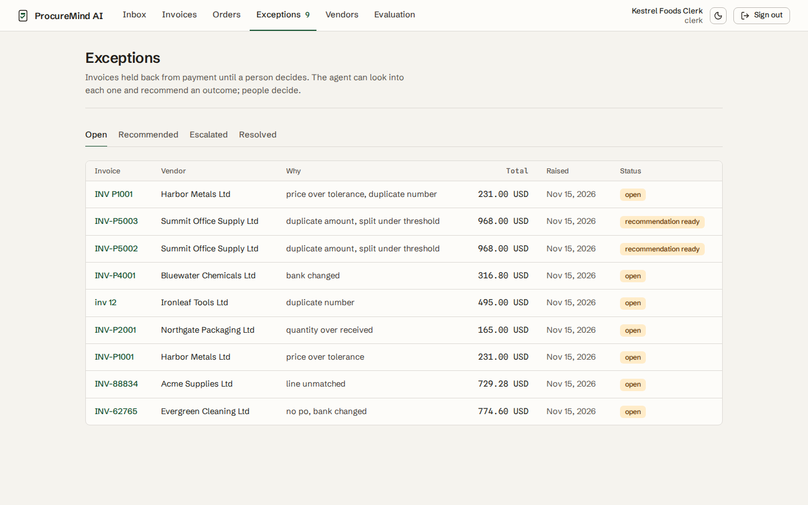

### 3. Ask the agent to investigate

1. Click an open exception, for example `INV-P1001`. Its page shows the reasons and the document.
2. Click **Ask the agent to investigate**. The status moves to *investigating*, then *recommendation ready*.
3. The panel **The agent recommends** shows one outcome and its evidence. With no model configured, the answer comes from a built-in script, and the panel says so. A clerk sees the recommendation but no **Accept this recommendation** button; only an approver or an administrator decides.

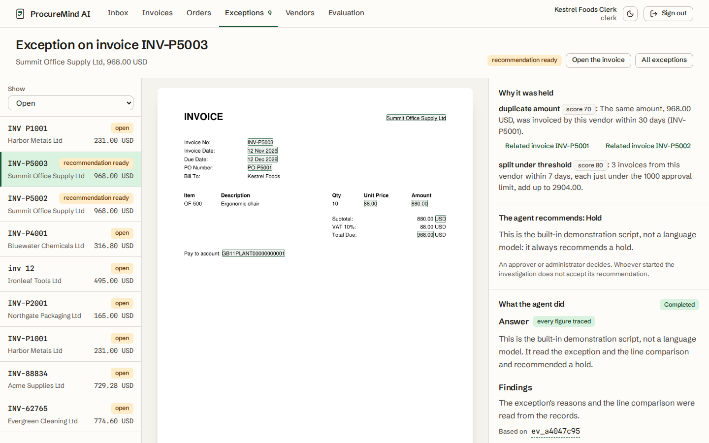

### 4. Upload a scanned duplicate and see it caught

1. Click **Inbox**. Click the drop zone and choose `samples/resent-invoice-scanned.pdf` from this repository (or drag it in). The file is a worn scan of an invoice Kestrel already received, numbered `inv-p1001`.
2. Wait for the row to reach *extracted*. OCR takes some seconds. In the **What arrived** panel, click **Open the invoice**.
3. The invoice is an exception: its number matches `INV-P1001`, and it bills more than was received. Under **Exceptions**, its reasons include *duplicate number*.

`samples/resent-invoice-digital.pdf` is the same invoice as a digital PDF, which is read from its text layer without OCR.

### 5. Review an invoice with highlighted fields

1. Click **Invoices**, then click any row, for example `INV-P5001`.
2. The **What was read** panel lists each extracted value with the confidence it was read with.
3. Click a value such as **Total**. Its box is highlighted on the document at the left, so you can see where the value came from. On a scan, the note *Read by OCR from a scan.* appears.
4. Use **Hide the document** and **Show the document** to hide or show the page image.


### 6. Decide as an approver

1. Click **Sign out** at the top right, then sign in as `approver@kestrel.demo` with `Approver#Demo2026`.
2. Click **Exceptions**, open `INV-P5003` (status *recommendation ready*), and click **Accept this recommendation**. The page shows *Resolved* with the outcome. To choose another outcome, pick it from **Outcome** and click **Record the decision**; for the duplicate, choose **Reject as a duplicate**. Whoever started the investigation cannot accept its recommendation while another approver is available.
3. Click **Approvals** in the top bar. The **Mine to decide** tab lists invoices waiting for approval. Open one and click **Approve**. The page shows **Approved for payment.** An invoice above the first approval tier shows *Still waiting for 1 more approval* until a second approver or an administrator approves it.

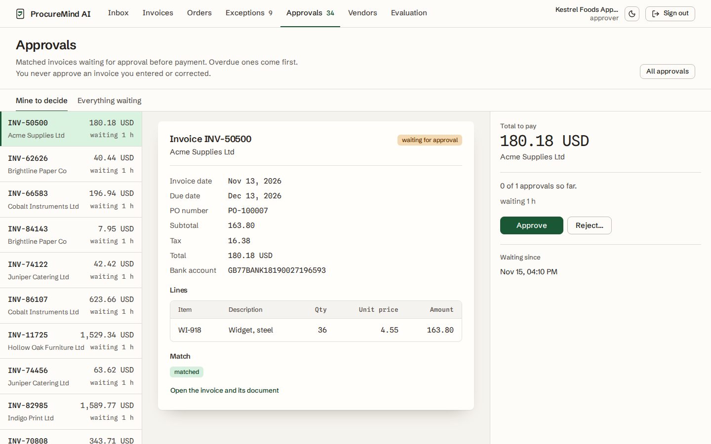

### 7. See separation of duties

You cannot approve an invoice you entered, corrected or matched yourself. To see it:

1. Sign in as `admin@kestrel.demo` with `Admin#Demo2026`.
2. Open a waiting invoice, click **Send back for correction**, then **Correct** on a field, **Save**, and **Match again**.
3. Click **Approvals**, the **Everything waiting** tab, and open the same invoice. The page says *entered or corrected this invoice* and offers no **Approve** button. A direct request to the approve endpoint is refused with HTTP 403.

### 8. Change a vendor's bank details with two administrators

1. Still as the administrator, click **Vendors** and open a vendor. Click **Change bank details**, enter **IBAN or account number** and **Bank**, and click **Request the change**. A banner says the change is waiting for a second administrator, and payments keep going to the account in use.
2. Add a second administrator: click **Administration**, then **People and roles**, and use **Add a person** (name, e-mail, password, and role *admin*) with **Add person**.
3. Sign out, sign in as the second administrator, and open the same vendor. Click **Approve** beside the pending account. The page confirms that payments now go to the new account. The administrator who made the request cannot decide it while another active administrator exists. A sole administrator may decide it, and the decision is recorded.

### 9. Connect a real model

1. Sign in as an administrator and click **Administration**, then the **Model** tab.
2. Set **Provider** (OpenAI-compatible, Anthropic or Ollama), **Model**, **Base URL** if your provider needs one, and **API key**. The key is stored encrypted and is not shown again.
3. Click **Save**; the page confirms *Model settings saved.* Click **Test the saved settings** to check the connection.
4. From now on the Exception Agent uses this model, and extraction proposes values alongside the rules. Run **Ask the agent to investigate** again on an open exception to see the difference. The demo's built-in script is no longer used for new runs.

Settings can also come from `.env` (see [Adding an AI model](#adding-an-ai-model)). Do not put keys in documentation, screenshots or the repository.

## Configuration

All settings are environment variables. [`.env.example`](.env.example) lists them with their defaults.

| Group | Variables |
|---|---|
| Secrets | `SECRET_KEY` (encrypts provider keys saved from the UI), `POSTGRES_PASSWORD`, `PROCUREMIND_OWNER_PASSWORD`, `PROCUREMIND_APP_PASSWORD` |
| Accounts | `SEED_DEMO`, `DEMO_SCALE`, `ALLOW_SIGNUP`, `COOKIE_SECURE`, `CORS_ORIGINS` |
| Network | `WEB_BIND` (address the UI is published on; `127.0.0.1` by default) |
| Model | `LLM_PROVIDER` (`openai_compat`, `anthropic`, `ollama` or `stub`), `LLM_MODEL`, `LLM_API_KEY`, `LLM_BASE_URL`, `LLM_FALLBACK_MODEL`, `LLM_PRICE_INPUT_PER_MTOK`, `LLM_PRICE_OUTPUT_PER_MTOK`, `ALLOW_PRIVATE_LLM_URLS` |
| Agent budgets | `RUN_MAX_STEPS`, `RUN_MAX_TOKENS`, `RUN_MAX_SECONDS`, `RUN_MAX_COST_USD`, `ORG_DAILY_COST_USD`, `GLOBAL_DAILY_COST_USD`, `ORG_MAX_CONCURRENT_RUNS`, `ORG_MAX_QUEUED_RUNS` |
| Agent behaviour | `AUTO_INVESTIGATE` (start the agent on every new exception; set a real model first) |
| Scale | `WORKER_CONCURRENCY`; `docker compose up --scale api=N --scale worker=N` |
| Observability | `METRICS_TOKEN`, `OTEL_EXPORTER_OTLP_ENDPOINT`, `OTEL_EXPORTER_OTLP_HEADERS` |

### Adding an AI model

ProcureMind runs on the rules and the built-in script by default. A model can be added in either of two ways.

**From the application.** An administrator opens **Administration → Model settings**, selects a provider, enters the model and the API key, and saves. The settings belong to that organisation and apply to the next run or document. The key is stored encrypted and is not returned by the API.

**From the environment.** The `.env` values are the default for every organisation until settings are saved in the application:

```bash
LLM_PROVIDER=openai_compat          # openai_compat | anthropic | ollama | stub
LLM_BASE_URL=http://host.docker.internal:<port>/v1   # an OpenAI-compatible gateway; Ollama's address when used
LLM_API_KEY=...
LLM_MODEL=<model id>
```

For documents that must not leave the network, use `LLM_PROVIDER=ollama` with a local model, or stay on the rules and the built-in script.

## Screenshots

| | |
|---|---|
| 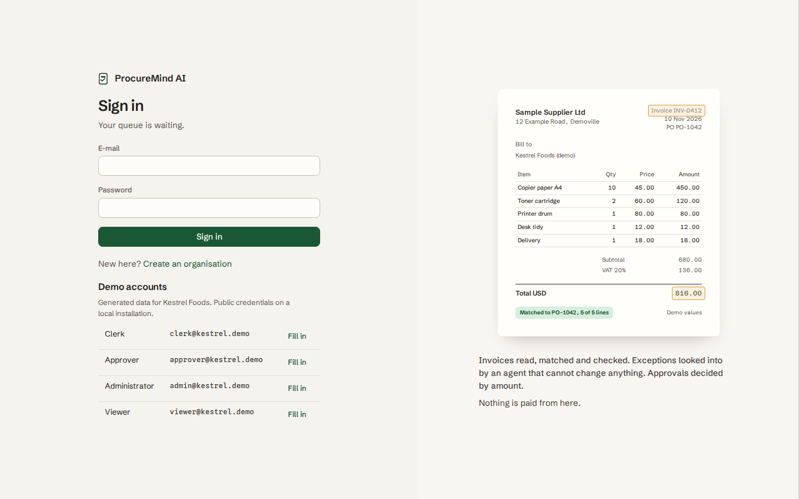 | 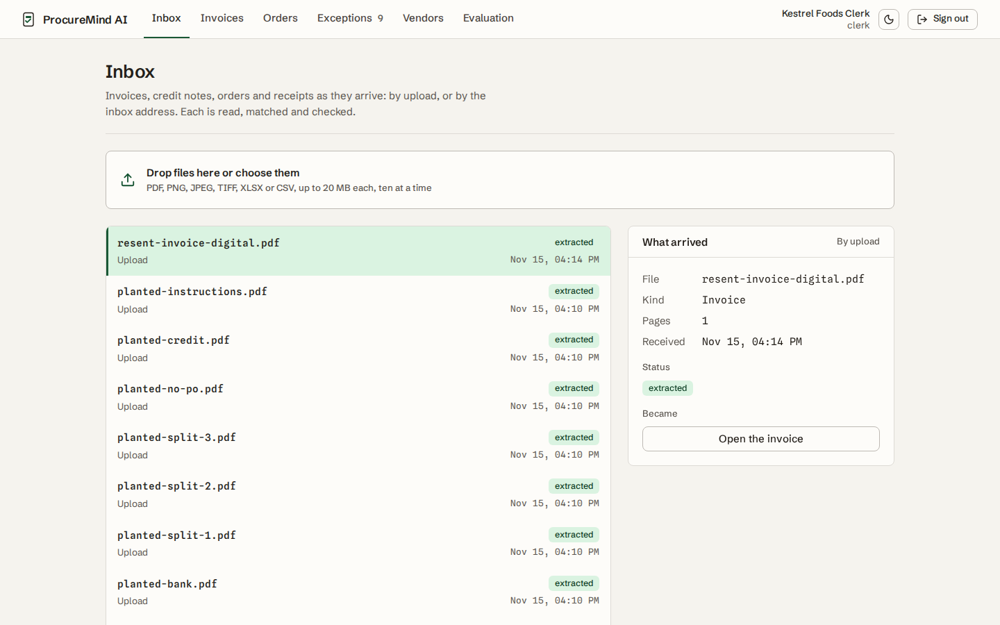 |
| **Sign in** with the demo accounts listed | **Inbox**: uploads and inbound documents, with their state |
| 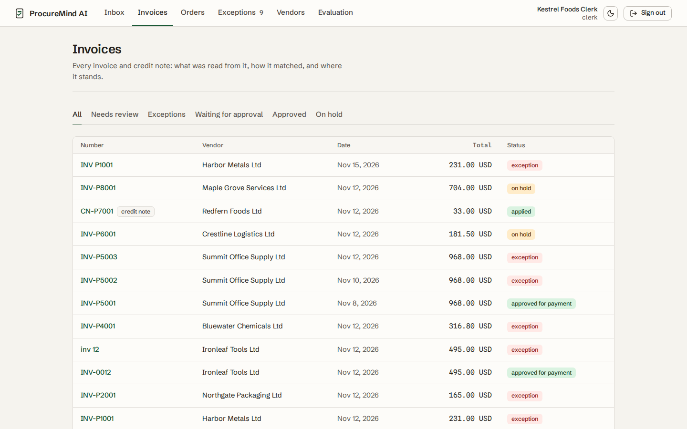 |  |
| **Invoices**: every invoice, its status and total | **Invoice review**: the value selected in *What was read* is highlighted on the page |
| 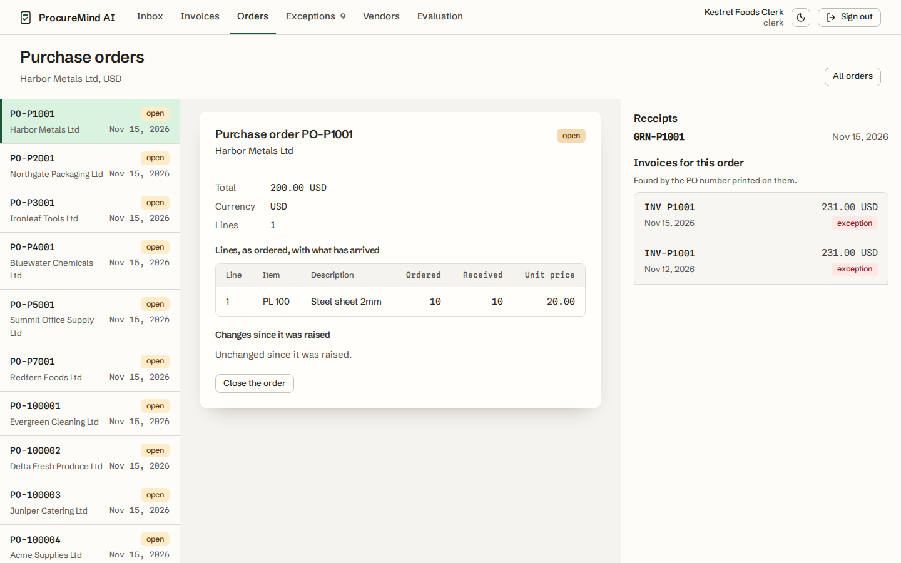 |  |
| **Purchase orders**: lines as ordered and received, with the invoices against them | **Exceptions**: invoices held until a person decides |
|  |  |
| **Exception with its recommendation**: the demo recommendation comes from the built-in script | **Approvals**: invoices waiting for approval, decided by approvers |
| 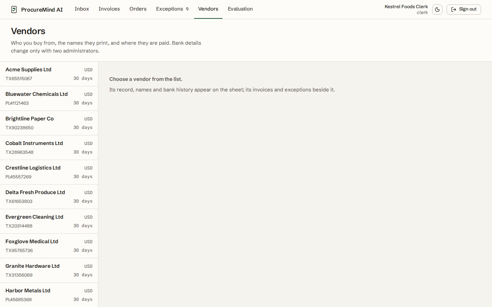 | 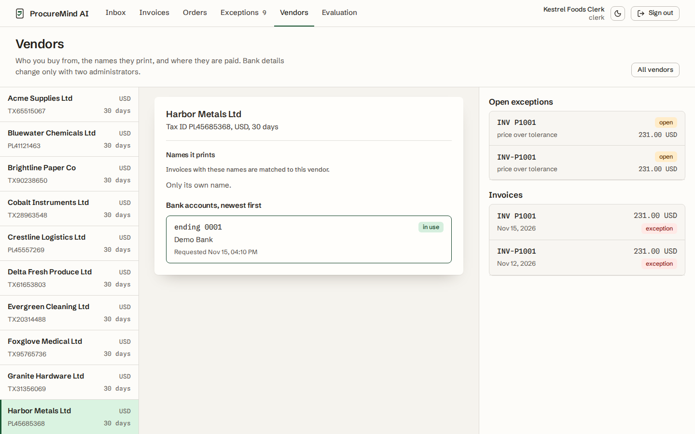 |
| **Vendors**: names printed, payment terms and bank status | **Vendor record**: open exceptions and invoices for one vendor |
| 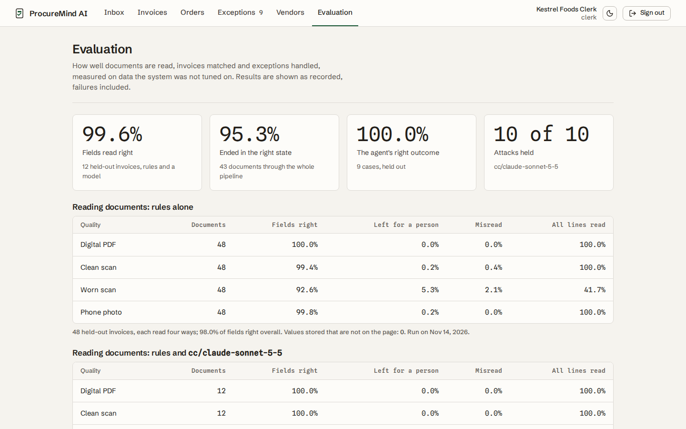 | 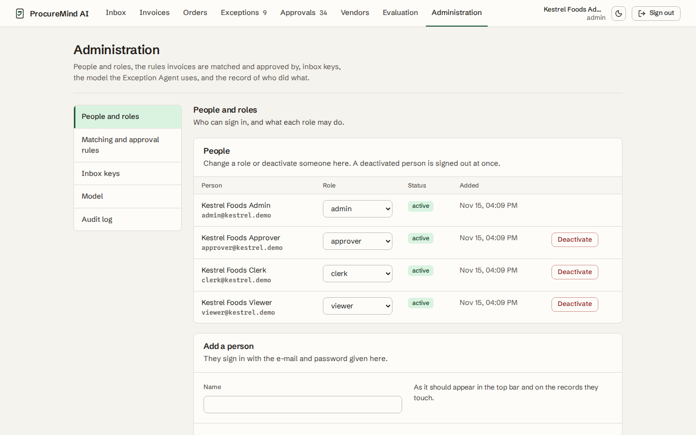 |
| **Evaluation**: the recorded results, failures included | **Administration**: people and roles, rules, inbox keys, model settings and the audit log |
| 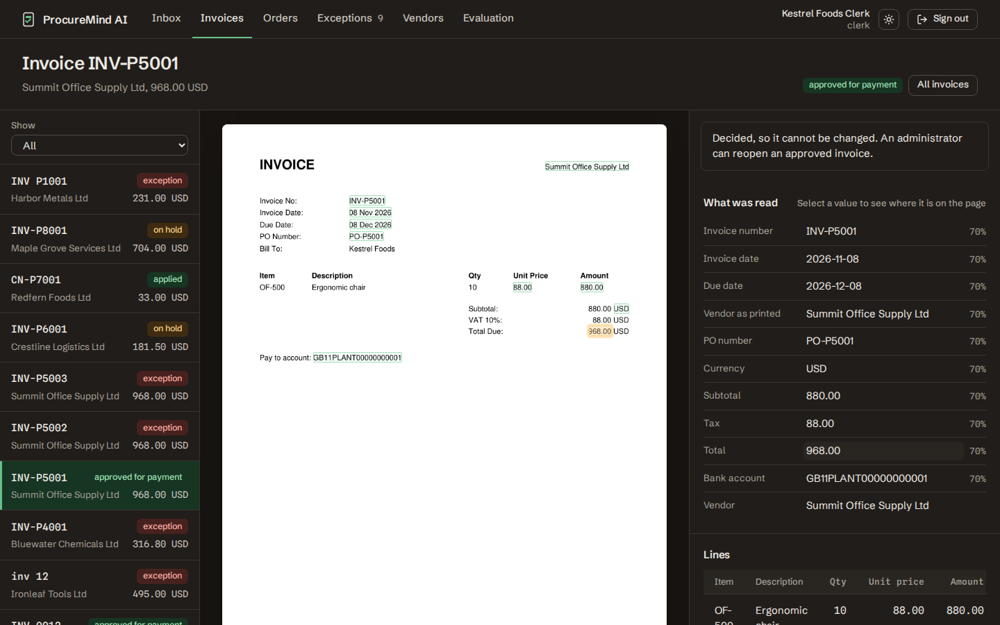 | |
| **Dark theme**: the invoice review | |

## Evaluation

Measured on 2026-11-14 on a single laptop. The method, the failures and the limits are in the linked documents.

| Question | Script | Headline |
|---|---|---|
| Does it read documents correctly, and never invent a value? | `eval/run_extraction.py` | 98.0 % of fields right by rules alone, 99.6 % with a model; **0 invented values in 240 renders** |
| Do the matcher and checks reach the right decision? | `eval/run_matching.py` | 95.3 % of documents end in the right state; findings recall 100 %, precision 73 % |
| Does the Exception Agent recommend what an AP lead would? | `eval/run_eval.py` | Held out: Claude Sonnet 5.5 9 / 9, GPT-6 Sol 9 / 9 |
| Does it hold under attack? | `eval/attacks.py` | 10 / 10 held (Claude Sonnet 5.5), judged in the database |

Method and full tables: [docs/EVALUATION.md](docs/EVALUATION.md). Failures and limits, as recorded in the evaluation:

- Worn scans lose fields: rules alone read 92.6 % of fields right on worn scans, and 5.3 % are left for a person. Clean scans, digital PDFs and phone photos are at 99.2 % or better with rules alone.
- In the matching run, two of 43 documents were not in the right state. Both were worn scans: one went to review with fields missing, one became a `no_po` exception because OCR lost its PO number.
- Of the three wrong findings, two are `duplicate amount` on the split-invoice case. Those invoices really do share a total within 30 days, but the answer key does not list it.
- GPT-6 Sol missed one held-out case in its first run (*hold* rather than *reject as a duplicate* on a duplicate) and none in the re-run after the review fixes; one run per model, so that is within run-to-run variation.
- `cx/gpt-5.5` refused every call on the gateway account. That run is kept as an unavailable result and not counted; GPT-6 Sol was used instead.
- Samples are small: 48 documents (12 with a model), 43 in the matching run, 9 held-out agent cases per model. The documents are synthetic.

### Scale

[docs/SCALE.md](docs/SCALE.md) has the method. Measured on one laptop on 2026-11-14. The machine was shared: an unrelated workload used 5 to 7 of its 16 cores throughout, so these figures are lower bounds. The load generator ran on the same machine.

| Measurement | Result |
|---|---|
| Documents through the pipeline, digital PDFs, 1 / 4 workers | 221 / 715 a minute |
| Documents through the pipeline, clean scans (OCR), 1 / 4 workers | 16 / 66 a minute; four workers were 4.1 times as fast as one |
| Matching and checks, 300 invoices timed (38 exceptions opened) in a database of 100,000 invoices | p50 36.6 ms, p95 59.9 ms, max 84.3 ms |
| "My approvals" with about 500 invoices waiting, p50 | 71 ms, down from 1,239 ms after batching the queue |
| 1,000 simulated people, 4 API containers | 93 requests a second; p50 7.9 s, p95 23 s, 26 failed (no database connection free within 30 s) |
| 1,000 simulated people, 8 API containers | 176 requests a second; p50 2.3 s, p95 14 s, 14 failed |
| 1,000 simulated people, 4 containers, after overload became a 503 | 94 requests a second; 58 failed, all 503 "busy, retry in 5 s" |

For an accounts-payable team the realistic load is tens of people. In the words of `SCALE.md`, four API containers serve a team of 50 working continuously with room to spare.

## Before using this for anything real

Set your own `SECRET_KEY` and database passwords. The application refuses to start with `COOKIE_SECURE=true` while `SECRET_KEY` is empty or the public demo value. Also set `SEED_DEMO=false`, `ALLOW_SIGNUP=false` unless strangers should sign up, `COOKIE_SECURE=true` behind HTTPS, `ALLOW_PRIVATE_LLM_URLS=false` on a shared installation, and real model prices. The UI is published on 127.0.0.1 by default; set `WEB_BIND=0.0.0.0` only behind HTTPS, and publish nothing else. Read [docs/SECURITY.md](docs/SECURITY.md): it says what is defended, what is not, and why prompt injection is treated as unsolved.

## Security

The controls below are described in full, with the tests that prove them, in [docs/SECURITY.md](docs/SECURITY.md).

- **Separation of duties.** Whoever entered or corrected an invoice cannot approve it. The check runs inside the transaction that records the decision.
- **Approval tiers and one decision per invoice.** The approval needed depends on the invoice total. The invoice row is locked while a decision is recorded, so two approvers cannot both finish it.
- **Bank-detail changes.** One administrator requests a change and another decides it.
- **Values never invented.** A value is stored from extraction only if it is found on the page.
- **Tenancy in the database.** PostgreSQL row-level security applies to every query, and the application connects as a role that is not the table owner.
- **The agent cannot change records.** Its tools are read-only, except for storing a recommendation and a draft for a person to review. Printed text is treated as data; prompt injection is treated as unsolved, and the design limits what a successful injection can do.
- **Sessions and requests.** Sessions are server-side in an HttpOnly cookie. Changes require a CSRF token, and sign-ins are rate limited.
- **Uploads.** Files are typed by their content, limited to 20 MB and 200 PDF pages, and never executed.

Known limits: no independent security audit has been carried out, no antivirus scanning is done on uploads, and prompt-injection results come from one model.

**Reporting a vulnerability.** Do not open a public issue. Open a private security advisory on this repository's GitHub page (the **Security** tab, then **Report a vulnerability**).

## Documentation

| Document | What is in it |
|---|---|
| [docs/ARCHITECTURE.md](docs/ARCHITECTURE.md) | Components, request paths, the document pipeline, approvals, the agent loop, design decisions and their costs |
| [Architecture diagram](https://rafi0020.github.io/ProcureMind/diagram/) | The interactive architecture diagram. Generated from [docs/architecture.diagram.json](docs/architecture.diagram.json) |
| [docs/PROMPTS.md](docs/PROMPTS.md) | Every prompt sent to a model, its guardrails and how its output is checked |
| [docs/AI_DISCLOSURE.md](docs/AI_DISCLOSURE.md) | The AI tools used to build the project, what they produced, and how it was verified |
| [docs/LEARNING.md](docs/LEARNING.md) | A guided read of the code in the order a document travels, with the tests that show each behaviour |
| [docs/SECURITY.md](docs/SECURITY.md) | What is defended and how, the OWASP LLM Top 10 mapping, known limitations |
| [docs/EVALUATION.md](docs/EVALUATION.md) | Method and results of the four evaluations, failures included |
| [docs/SCALE.md](docs/SCALE.md) | Throughput, matching time at 100,000 invoices, query plans and read load on one laptop |
| [docs/API.md](docs/API.md) | Every endpoint |
| [docs/DATABASE.md](docs/DATABASE.md) | Tables, row-level security and the roles that use them |
| [docs/PROVIDERS.md](docs/PROVIDERS.md) | Settings for every model provider and for local models |
| [docs/test-results](docs/test-results) | The backend test run: JUnit XML and console output |
| [samples/README.md](samples/README.md) | The sample documents for the demo |

## Repository layout

```
procuremind/
  backend/            FastAPI application (app/), migrations (alembic/), demo data (seed/),
                      evaluation (eval/), load tests (load/), tests (tests/)
  frontend/           Next.js 15 UI, exported as static files (src/), Playwright journeys (e2e/), nginx.conf
  infra/              PostgreSQL initialisation script and the PgBouncer image
  docs/               Architecture, prompts, security, evaluation, scale, API, database, providers, learning notes,
                      screenshots/ (README images), test-results/ (JUnit and console output)
  samples/            Sample invoices for the demo, with samples/README.md
  docker-compose.yml  the stack; the test profile runs the OCR tests and the evaluation
  docker-compose.load.yml   the load-test overlay, which uses a separate database
  Makefile            checks, tests, evaluation
  .env.example        every setting, with its default
  LICENSE             MIT licence
```

## License

Released under the [MIT License](LICENSE).
