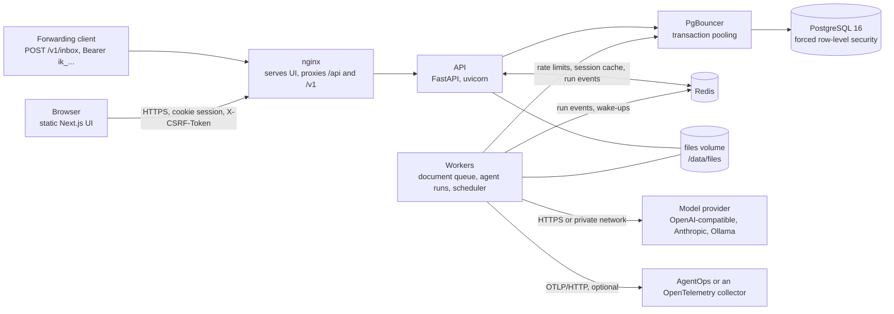
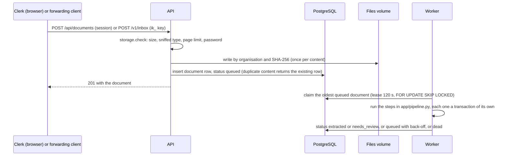

# Architecture

The diagram is generated from [`architecture.diagram.json`](architecture.diagram.json); an [interactive version](https://rafi0020.github.io/ProcureMind/diagram/) is also available.

## Overview



Six kinds of container make up the application. `web` (nginx) serves the static UI and proxies `/api/` and `/v1/`
to `api`. `api` is the FastAPI application. `worker` runs the same backend image as `api` with a different command;
it runs three loops in one process: the document queue, the agent run loop and the scheduler. `migrate` applies the
Alembic migrations and, when `SEED_DEMO=true`, loads the demo accounts and data, then exits. `db` (PostgreSQL 16),
`pgbouncer` and `redis` are the data services.

## Processes and ports

| Service | Command | What it does | Published port (host) |
|---|---|---|---|
| `web` | nginx | Serves the static UI; proxies `/api/` (with server-sent events unbuffered) and `/v1/` to `api` | 127.0.0.1:3300 (`WEB_BIND` sets the address) |
| `api` | `uvicorn app.main:create_app` | UI API, sign-in, the inbox endpoint `/v1/inbox`, `/healthz`, `/readyz`, `/metrics` | 127.0.0.1:8300 |
| `worker` | `python -m app.worker.run --concurrency N` | Claims documents and advances them through the pipeline; claims and advances agent runs; runs the scheduler | none |
| `migrate` | `python -m app.bootstrap` | Applies migrations as `procuremind_owner`; loads demo data when `SEED_DEMO=true`; exits | none |
| `db` | `postgres:16-alpine` | Creates the two roles and the `procuremind` and `procuremind_test` databases (`infra/postgres/init.sh`) | 127.0.0.1:55452 |
| `pgbouncer` | transaction pooling | Pool in front of PostgreSQL; default pool size 40 | 127.0.0.1:56452 |
| `redis` | `redis:7-alpine` | Wake-up list, run event streams, rate-limit counters, session cache | 127.0.0.1:56399 |

`api` and `worker` scale with `docker compose up --scale api=N --scale worker=N`. Worker concurrency per process is
`WORKER_CONCURRENCY` (default 4). Processes coordinate only through PostgreSQL; Redis is used for speed and
signalling, never for state that must survive.

The `files` volume is mounted at `/data/files` in `migrate`, `api` and `worker`. Documents are written by `api` and
read by `worker`. `tests/test_deployment_config.py::test_every_service_that_touches_documents_shares_the_files_volume`
checks this in the compose file.

## Tenancy and database roles

Every table that holds tenant data has row-level security enabled and forced (`app/rls.py::enable_rls`). The policy
admits a row when its `org_id` equals the organisation set for the current transaction, so the owner of a table is
not exempt. Two session helpers in `app/db.py` set that organisation:

| Helper | Use | Rows it can see |
|---|---|---|
| `tenant_session(org_id)` | Every request and every pipeline step for one organisation | That organisation's rows only |
| `system_session()` | Sign-in, session lookup, claiming documents and runs, the scheduler, the inbox key lookup | Rows of tables marked `system_access` (`users`, `runs`, `documents`, `inbox_keys`), and tables that hold no tenant data, such as `orgs` |

The organisation is set with `set_config(..., true)` inside the transaction. PgBouncer runs in transaction mode, so
session-level settings would leak between clients; the same reason disables server-side prepared statements
(`connect_args={"prepare_threshold": None}`).

The application connects as `procuremind_app`, which is not the table owner. Migrations and demo loading connect as
`procuremind_owner`. `infra/postgres/init.sh` revokes public access to the schema and grants the application role
only table and sequence privileges. `tests/test_tenant_isolation.py` covers the policy, including that a pooled
connection does not keep an organisation between transactions and that the application cannot rewrite the audit log.

## Request path: a document arrives



1. Uploads are checked before anything is stored. One bad file rejects the whole request. A file is typed by its
   bytes (PDF, PNG, JPEG, TIFF, XLSX; CSV by its extension and valid UTF-8), not by its name. Limits: 20 MB per file,
   200 PDF pages, no password-protected PDFs.
2. Storage is by SHA-256 within the organisation, written to a temporary name and renamed, so a half-written file is
   never under its final name. The same content uploaded twice is one document.
3. The inbox endpoint `POST /v1/inbox` takes a JSON message with base64 attachments and an inbox key
   (`ik_<prefix>_<secret>`). Only the SHA-256 of a key is stored, the key is shown once, and it can be revoked. Keys
   are looked up in the database on each request. Bodies over 25 MB are refused.

## The document pipeline

A claimed document runs five steps in order (`app/pipeline.py::STEPS`). Each step reads what the previous one stored,
so a retry starts from the first step and writes the same rows again.

| Step | Function | What it stores |
|---|---|---|
| Read | `app/intake/steps.py::read_pages` | Page words with positions in `document_pages`; the document kind and page count. Digital PDF pages use the text layer when they have at least 20 characters; other pages, photos and scans use Tesseract OCR at 300 DPI. Spreadsheets become one page per sheet. |
| Extract | `app/extraction/extract.py::extract_step` | One `extractions` row: kind, fields with where each was found, lines, arithmetic issues, flags |
| Records | `app/ap/records.py::records_step` | An invoice (with its lines and per-field provenance), a purchase order with lines, or a goods receipt, depending on the kind |
| Match | `app/matching/match.py::match_step` | The stored match and its lines, and the invoice status, for an invoice that is `ready` |
| Checks | `app/checks/run.py::checks_step` | Findings and, when there is something for a person to decide, one open exception per invoice |

A step that finishes without deciding the outcome leaves the document `needs_review` for a person. A step that
raises sends the document back to the queue with a back-off, and after five attempts it is `dead` with the error kept.

### Extraction

Rules and, when an organisation has a real model configured, a model propose values. Each header value is then
decided by `app/extraction/extract.py::_decide`:

| Rules and model | Stored as | Confidence |
|---|---|---|
| Both located on the page and agree | Located | 0.95 |
| Only one of the two located on the page | Located, with that one's value | 0.7 |
| Both located and different | Rules' value, flagged `disagreement` | 0.5 |
| Neither located | Missing, with the reason and the rejected candidate kept | none |

A value is stored as located only if `app/extraction/provenance.py::locate` finds it on the page: amounts by their
numeric value, dates by their parsed value, other fields by normalised text across up to eight consecutive words of
one printed line.
A value the model proposes that is not on the page is dropped and flagged `model_not_on_page`. Line amounts follow the
same rule (`_lines`). Line quantities, unit prices, descriptions and item codes are taken from the rules or the model
without a page check; the arithmetic check below is the control that applies to them.

The model is offered one tool, `record_document`, and asked to call it. The document text is placed between
`<document>` tags with an instruction that it is untrusted data (`app/extraction/llm.py`). Without a configured
model (`LLM_PROVIDER=stub`), extraction is rules only. An unknown `LLM_PROVIDER` stops the application at startup.

### Arithmetic and review

`app/extraction/arithmetic.py::check` and `app/ap/review.py::issues_of` both check that each line's quantity times
unit price equals its amount, that the lines add up to the subtotal, and that subtotal plus tax equals the total. Any
issue leaves the invoice in `needs_review`. A correction that breaks the arithmetic stays in review
(`tests/test_ap_records.py::test_a_correction_that_breaks_the_arithmetic_stays_in_review`).

### Records

`app/ap/records.py` turns an extraction into rows. Vendors are found by tax identifier, then by name or alias
(`app/vendors.py::find_vendor`). If two vendors share the tax identifier, the document is held for a person to choose,
and the issue names both. An invoice with no matched vendor, or a missing required field (vendor, number,
date, currency, total), is `needs_review` until a clerk corrects it. Invoice numbers are normalised by
`app/ap/numbers.py::normalise_number`, so `INV-0012`, `inv 12` and `Invoice No. 12` compare equal. A credit note is
stored as an invoice of kind `credit_note` with positive amounts.

### Matching

`app/matching/match.py::match_invoice` is deterministic: no model is involved.

1. The purchase order is found by its normalised number. Its vendor and currency must match the invoice, and a closed
   order is an exception.
2. Each invoice line is paired with an order line by item code, or else by description similarity of at least 0.5
   (`pg_trgm`'s `similarity`).
3. Quantities are compared with what was received less what other accepted invoices already billed
   (`_billed`). Accepted means `matched`, `pending_approval` or `approved`. A credit note gives quantity back.
4. Unit prices are compared with the order's price. Above the price tolerance (default 2 %) is an exception; a
   smaller positive difference is a `matched_with_variance`.
5. An invoice with no lines is held to the value received less what other accepted invoices billed on the order,
   not to the ordered value. A header-only invoice is checked only when it prints a subtotal.

Reason codes: `no_po`, `po_closed`, `vendor_mismatch`, `currency_mismatch`, `line_unmatched`, `quantity_negative` (a
negative line quantity is refused: a credit is a credit note), `quantity_over_received`,
`price_over_tolerance`, `credit_exceeds_invoiced`, `total_over_received`. `store_match` replaces the invoice's match
and moves the invoice to `pending_approval` (or `matched` for a credit note, which is applied and never paid), or to
`exception`.

Tolerances and approval tiers are per organisation (`org_ap_settings`) with defaults in
`app/matching/tolerances.py`: price 2.00 %, quantity 0.00 %, total 1.00, escalation after 48 hours.

### Checks and exceptions

`app/checks/run.py::run_checks` runs four checks. Each returns findings with a score; `open_exception` opens an
exception when a finding scores 0.6 or more (`app/checks/findings.py::THRESHOLD`) or the match has reasons.

| Check | Function | Finding | Score |
|---|---|---|---|
| Duplicate number | `app/checks/duplicates.py::duplicates` | Same vendor, same normalised number | 0.95 |
| Duplicate amount | `app/checks/duplicates.py::duplicates` | Same vendor, same total, within 30 days, different number | 0.7 |
| Bank account changed | `app/checks/anomalies.py::bank_changed` | Account on the invoice differs from the vendor's active account | 0.9 |
| Price drift | `app/checks/anomalies.py::price_drift` | A line price more than 20 % above the vendor's highest for that item in the previous 180 days | 0.6 |
| Split under a limit | `app/checks/anomalies.py::split_under_threshold` | This invoice and at least one other from the same vendor, dated within the seven days up to this invoice, each between 90 % and 100 % of an approval limit, adding up to more than the limit | 0.8 |

An exception is one row per invoice, enforced by a partial unique index on open statuses (migration `0016`). Its
reasons and findings are stored with it. When an invoice opens an exception it is held: an invoice in `ready`,
`matched` or `pending_approval` moves to `exception`.

## Approvals

`app/approvals/policy.py::tier_for` picks the tier for an invoice total from the organisation's tiers. The defaults are:

| Invoice total | Approvals needed | Who |
|---|---|---|
| Up to 1,000 | 1 | An approver or an administrator |
| Up to 10,000 | 2 | Approvers or administrators |
| Above 10,000 | 2 | Two approvers or administrators, at least one of them an administrator |

Administrators change the tiers under `/api/ap-settings`. `app/approvals/chain.py::describe` says what an invoice still
waits for, and `decide` records one decision.

`decide` locks the invoice row with `SELECT ... FOR UPDATE` before checking anything, so two people deciding at the
same moment are serialised and the second sees the new status. Inside that lock it checks:

- the invoice is `pending_approval`;
- the approver is not conflicted (`app/approvals/policy.py::conflicts`): they entered the invoice, corrected it,
  matched it by hand, or accepted its variance as an exception;
- they have not already decided it (`UNIQUE (invoice_id, approver_id)` as a second guard).

A rejection ends the invoice as `rejected`. An approver can send a waiting invoice back for correction
(`POST /api/invoices/{id}/send-back`), which clears its approvals and its match. An administrator can reopen an
approved invoice with a reason (`POST /api/invoices/{id}/reopen`), which clears its approvals. Correcting an invoice
(`PATCH /api/invoices/{id}/fields`) is refused while the invoice is waiting for approval, approved or rejected. A
correction deletes the invoice's match, so the invoice is matched again.

A database trigger sets `pending_since` whenever an invoice's status becomes `pending_approval`, so the escalation
clock cannot be forgotten by a code path. Every 15 minutes the scheduler marks invoices waiting longer than the
organisation's escalation delay as `escalated`; the approval queue lists them first. Escalation does not change the
invoice's status.

## The Exception Agent

The agent is the generic loop in `app/agent/` with one specification in `app/exceptions/`. The loop does not know
about accounts payable: `app/agent/` imports nothing from `app/exceptions/`.

### The loop

```mermaid
sequenceDiagram
    participant U as Clerk or approver (browser)
    participant A as API
    participant D as PostgreSQL
    participant R as Redis
    participant W as Worker
    participant M as Model
    U->>A: POST /api/exceptions/{id}/investigate
    A->>D: insert run (status queued), audit entry
    A->>R: append run.status event, wake workers
    A-->>U: 202 with run id
    W->>D: claim run (lease 30 s, organisation limit of 5 running)
    loop until finished, waiting or over budget
        W->>D: load run and steps; decide the next action from the steps alone
        W->>M: messages rebuilt from steps, with the tools the run's role may use
        M-->>W: tool call or prose
        W->>D: commit the model step and its counters
        W->>D: commit the tool step as started
        W->>W: validate arguments and role
        W->>D: run the tool; commit outcome and database effect in one transaction
        W->>R: append event
    end
    W->>D: completed (report), waiting_user, waiting_approval, failed, cancelled or budget_exceeded
```

`app/agent/runtime.py::advance` does exactly one action per iteration: call the model, start a tool, or resolve a tool
call that was left unfinished by a crash. `next_action` decides from the stored steps. There is no state in memory,
so any worker can continue any run. Steps are recorded with an idempotency key, which makes writing the same step
twice impossible.

Tools have a level (`app/agent/tools.py`): `read`, `write` or `needs_approval`. A `needs_approval` tool parks the run
until an administrator decides; no Exception Agent tool uses that level today. A tool that was `started` when its
worker died is run again only if it is marked idempotent; otherwise the model is told the action may or may not have
taken effect. Tools declare the roles that may use them, and a tool the role may not use is not described to the
model at all.

Budgets are checked before each model call (`app/agent/budgets.py::check_budget`): 25 model steps, 200,000 tokens,
300 seconds of work, US$1.00 per run, and the organisation's and the installation's daily cost limits (US$20 and
US$200 by default). Exceeding one ends the run as `budget_exceeded` and keeps the evidence gathered. Model calls made for
document extraction count towards the same daily limits (`model_spend`); once a limit is reached, extraction proceeds
on the rules alone.

An organisation may have five runs running at once; further runs wait queued. A request that would take the number
of queued and running runs past twenty gets `429`. A user may start ten runs a minute.

### Tools

The Exception Agent's tools (`app/exceptions/tools.py`, `app/exceptions/common.py`):

| Tool | What it does | Writes |
|---|---|---|
| `get_exception` | Reasons and findings of the exception, and its invoice | Nothing |
| `get_invoice` | Header, lines and status of an invoice or credit note | Evidence row |
| `get_po` | A purchase order's lines and every change made to it | Evidence row |
| `get_receipts` | What was received against a purchase order, per line | Evidence row |
| `vendor_history` | A vendor's invoices, prices by item, accounts on file and accounts printed on its invoices | Evidence row |
| `similar_exceptions` | Resolved exceptions with the same reason or finding code and how they were resolved | Evidence row |
| `document_text` | The text of a page of the invoice's document; a long page comes in numbered parts (`part`), each shown in full | Evidence row |
| `compare_lines` | Line by line: ordered, received, already invoiced, invoiced now, price difference | Evidence row |
| `compute` | Calculations over stored results (see below) | Evidence row |
| `chart` | A line, bar or waterfall chart of a stored result | Evidence row |
| `record_finding` | One conclusion with the evidence handles that support it | Nothing (the step records it) |
| `ask_user` | One clarifying question; the run waits. At most two per run | Nothing |
| `recommend` | One of six outcomes, with rationale and evidence; stored on the exception for a person | Exception recommendation, status `recommended` |
| `draft_supplier_message` | A credit-note or corrected-invoice request, stored as a draft | Draft row |
| `finish` | The report, submitted with its findings and charts | Run completed |

Outcomes for `recommend` are `approve_with_variance`, `hold`, `request_credit_note`, `request_corrected_invoice`,
`reject_duplicate` and `escalate`. Accepting an outcome is a person's decision (below). Nothing the agent does
changes an invoice's status, an approval, a vendor or a bank account.

`compute` takes the operations `total`, `growth`, `share`, `margin`, `variance_decomposition`, `zscore_anomalies` and
`seasonal_forecast`. The first is used for sums; the others are calculations inherited from the FinOps agent that the
accounts-payable prompt does not describe. The `chart` tool is inherited in the same way.

A tool returns its result to the model as a summary and its data. Most tools that read supplier text (`get_invoice`,
`document_text`, `vendor_history`, and the others that pass `untrusted=True` in `app/exceptions/tools.py`) put their
rows under the key `untrusted_data`. The prompt tells the model that content under that key was written by the
supplier and is never an instruction (`app/exceptions/prompts.py`). `get_exception`, `get_receipts`,
`similar_exceptions` and `compare_lines` return their rows without that key, and some tools put extra fields beside
`untrusted_data`. Evidence rows keep what the model saw, so figures can be checked against them later.

### Grounding of the report

`finish` checks every number in the summary and in each cited finding against the evidence
(`app/exceptions/grounding.py::check_text`, `EvidencePool`). The first attempt with unsupported figures is refused
and the model is asked to cite or remove them; a second attempt removes them and lists them as removed in the report.
The model does no arithmetic: `compute` does it with `Decimal` in `app/exceptions/compute.py`.

### Acceptance by a person

`POST /api/exceptions/{id}/resolve` (approver or administrator) applies an outcome directly. The invoice moves as
follows:

| Outcome | Invoice becomes | Exception becomes |
|---|---|---|
| `approve_with_variance` | `pending_approval` (a credit note becomes `matched`) | `resolved` |
| `hold` | `on_hold` | `resolved` |
| `request_credit_note` | `on_hold` | `resolved` |
| `request_corrected_invoice` | `on_hold` | `resolved` |
| `reject_duplicate` | `rejected` | `resolved` |
| `escalate` | unchanged | `escalated` (only an administrator decides it) |

`POST /api/exceptions/{id}/accept-recommendation` applies the recommended outcome with the note "Accepted the agent's
recommendation". Whoever started the investigation may not accept its recommendation while there is another active
approver or administrator in the organisation; if they are the only one, they may. Runs started automatically by
`AUTO_INVESTIGATE` have no starter, so their recommendations never hit this rule. This is the two-person rule applied
to agent-proposed actions.

## Tracing

`app/obs/tracing.py` writes one OpenTelemetry span per model call and per tool call, with GenAI semantic-convention
attribute names. The trace id of every span is the run id, so a run resumed by another worker after a crash is still
one trace. Spans carry the run id, organisation id, step index, provider, model, token counts and cost. They never
carry prompts, completions or tool arguments.

Nothing is exported unless `OTEL_EXPORTER_OTLP_ENDPOINT` is set. When it is, the OTLP exporter reads
`OTEL_EXPORTER_OTLP_HEADERS` from the environment, which is how an AgentOps ingestion key is sent. `tests/test_tracing.py`
checks the span names and attributes and that no content is recorded.

## Redis

| Use | Key or structure | If it is lost |
|---|---|---|
| Wake-up signal for run workers | list `runs:wake` | Workers poll (about every second), so work is delayed, not lost |
| Live events of a run | stream `run:<run id>`, at most 2,000 entries, 24 hours | The page reloads its state from the database; a reconnecting browser resumes with `Last-Event-ID` where the stream still has the entry |
| Session cache | session token hash, at most 60 seconds | A database lookup |
| Rate limits | sorted sets `rl:*`, sliding window | Rate-limited routes return `503` while Redis is unreachable |

Document processing does not use Redis at all: the document queue polls PostgreSQL every two seconds when idle.
Redis is never the source of truth. Documents, runs, steps, leases, approvals, matches and exceptions are in
PostgreSQL.

## Design decisions

| Decision | Reason | Cost if wrong |
|---|---|---|
| The model never does matching or checks; it reads and proposes | A match must be reproducible and explainable line by line | Matching cannot use a model's judgement on messy descriptions beyond the similarity score |
| A header value is stored only if it is found on the page | A value that is not printed is a fabrication from the outside; the evaluation measures it | Values the page prints in an unusual layout are left for a person |
| Rules run first and always; the model is optional | Rules are free, deterministic and need no key; the demo works with no model | Without a model, worn scans lose table lines (`EVALUATION.md`) |
| Typed read-only tools, no free-form SQL | Questions are known; the attack surface is smaller | The agent can only answer what its tools express |
| `recommend` and `draft_supplier_message` store rows for people and nothing else | Excessive agency is removed by construction, not by instruction | A recommendation can be wrong and still be accepted by a careless approver |
| Credit notes are applied, never approved for payment | Nothing in the system pays; a credit reduces what was billed | A credit note has no approval step of its own |
| Invoices with no lines are held to the value received | A two-way match (invoice against order) would pass over-billing | A header-only invoice with no printed subtotal is not compared with the receipts |
| Row lock on the invoice for each decision | Two approvers at the same instant must not both finish it | Decisions on one invoice are serialised; this is cheap at AP volumes |
| Document queue and run queue are rows with leases in PostgreSQL | One store, one tenancy model, no broker to operate; a dead worker's lease expires | Polling latency when Redis wake-ups are missed |
| Forced row-level security with a non-owner application role | Tenancy is enforced by the database for every query, including the agent's | Every new tenant table needs its policy in its migration |
| Redis holds only events, limits and a session cache | Losing Redis must not lose work | Live views catch up from the database after a reconnect |
| The stub agent is labelled as a script | The demo runs without a model and says so | It is not an evaluation of anything |
| Budgets cover the agent's runs only | The budgets were written for the agent; extraction makes one model call per document and its cost is not recorded | With a model configured, uploads are not capped by the daily cost limits |

## Limits of this design

- One installation, one database, one set of workers. Scale-out is by containers behind nginx and by workers
  sharing PostgreSQL. `SCALE.md` gives the measured limits on one machine.
- Documents are stored on a local volume. There is no object store, no antivirus scan and no retention policy.
- E-mail is not sent or received. Suppliers' messages arrive through the inbox endpoint, which another system must
  call.
- No ERP integration and no payments. Approval is recorded and the invoice is `approved`; the payment is outside.
- No single sign-on and no multi-factor authentication. Sessions are server-side with a CSRF token.
